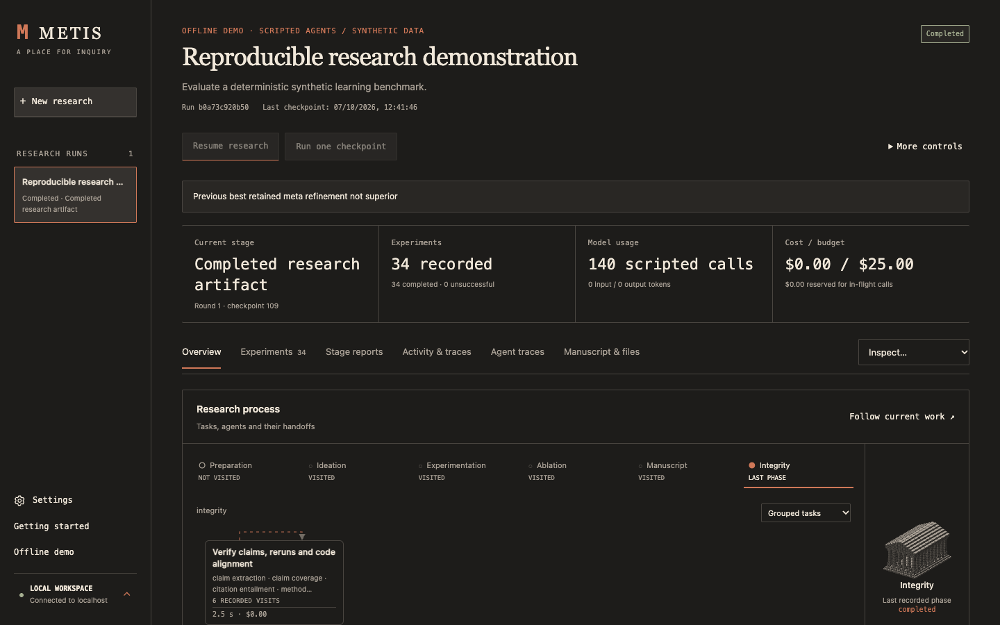
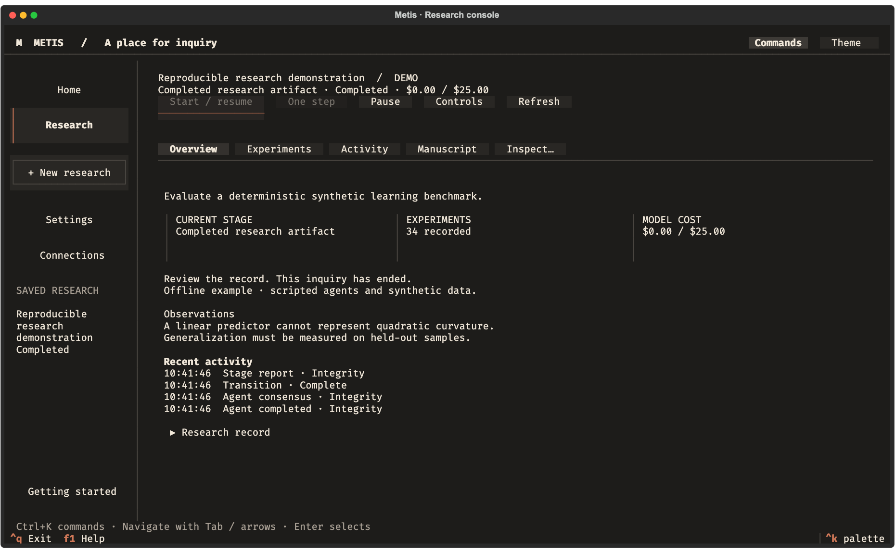
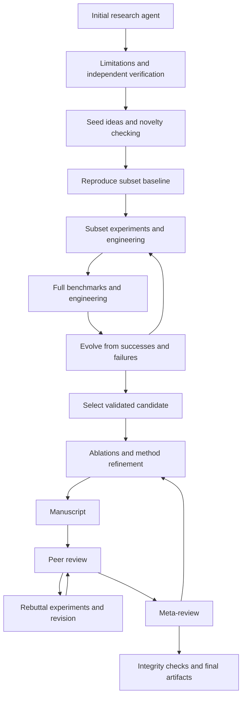

# Metis

**An open-source AI research platform that keeps every attempt, including the ones that failed.**

Metis takes a research question through literature review, ideation, coded experiments,
peer review and a written manuscript. Every model call, command, measurement and rejected
idea is recorded, so you can check how a conclusion was reached instead of trusting a
final summary. Use the web console, the terminal interface or the CLI.

<picture>
  <source media="(prefers-color-scheme: light)" srcset="docs/images/console-demo-light.png">
  
</picture>

<sub>The offline demo in the web console. Agents and review scores are scripted; the experiments run for real on synthetic data.</sub>

## Try it in a minute

No account, API key or model spending is needed. Requires Python 3.11+ and [uv](https://docs.astral.sh/uv/).

```bash
git clone https://github.com/tadteo/Metis.git && cd Metis
uv sync --frozen --group dev
uv run metis demo     # offline run: scripted agents, real synthetic experiments
uv run metis serve    # open http://127.0.0.1:8765 to inspect the record
```

Prefer the terminal? `uv run metis tui` opens the same record.



## What sets Metis apart

- **Failures are evidence.** Rejected hypotheses, failed commands and negative measurements
  are kept and fed back into later ideas. Nothing is deleted to make a run look better.
- **Measured claims only.** A candidate is promoted only by measurements from a protected
  evaluator the agents cannot edit. Numbers and statistics in the manuscript are checked
  against recorded results.
- **Budget limits.** Spending and call limits are reserved before each model call;
  experiment and wall-clock limits are checked before each experiment and step. Creating
  or configuring a run never spends anything.
- **Inspectable AI.** Agents, prompts, routing and the workflow are versioned
  [specifications](src/autoresearch/specs/). Each run archives them and detects drift on resume.
- **Your models, your compute.** OpenAI-compatible APIs, including local servers, with
  [sourced provider presets](docs/model-routing.md#provider-presets) for free tiers; Docker,
  local or Slurm execution; managed SSH controllers for remote hosts.

## Status and scope

Metis 0.1.0 is an experimental preview, developed independently by a single maintainer.
It draws on [ScientistTwo (Nam et al., arXiv:2609.19644)](https://arxiv.org/abs/2609.19644)
and extends its research loop with its own architecture, interfaces, execution policies
and evidence tracking. It has no affiliation with the authors and makes no claim of
reproducing the paper's scientific performance. Live manuscripts use pinned official
PaperOrchestra agents; peer review uses the released ScholarPeer Appendix G prompts with
reconstructed orchestration.

The offline demo is synthetic. Public-data baseline measurements do not establish
autonomous research quality, and paid end-to-end runs have not yet been certified. Read
the [fidelity report](docs/fidelity.md) before using any output as research evidence.
Start with the [documentation index](docs/README.md) and [security guide](SECURITY.md).

Contributions are welcome: see [CONTRIBUTING.md](CONTRIBUTING.md). Sharing a recorded
live run is especially valuable, because it is the evidence this project needs most.

## Install and configure

The package is `metis-research` and the primary command is `metis`. The `autoresearch` command remains a compatibility alias. Python imports (`autoresearch`), `AUTORESEARCH_*` environment variables and existing private-state paths remain supported.

From this checkout (see the prerequisites above):

```bash
uv sync --frozen --group dev
uv run metis serve
```

Open [the research console](http://127.0.0.1:8765). **Workspace settings** begins with Model access. Enter the model ID and API address, paste your key into the dedicated password field, then choose **Save API key**. Metis stores it in the server host's supported OS credential vault, or for the current server session when vault storage is unavailable. On an SSH console, storage is on the remote host. **New research** begins with a question and project folder, suggests a run name from the question, and reuses model settings. Checking setup and creating a run do not start research or make paid model calls. Execution starts when you explicitly choose Start, Step or Resume.

New research needs a question, optional papers and an optional project folder. Select an
existing folder or let Metis create one automatically. The initial agent discovers
relevant literature and understands new, partial or existing work. After **Start**,
the coding agents prepare executable experiments, measurement and published reference
values. All preparation shares the run's model budget; there is no separate paid setup
proposal or manual baseline/evaluator form. See [the inquiry guide](docs/usage.md#begin-with-a-question).

Model access and compute settings remain reusable. Creating an inquiry does not run a
provider or experiment. Agents retain failed attempts, check their measurement protocol
and request clarification when evidence or access is missing. Existing configured
studies keep their explicit compatibility path, and saved runs keep behavior-drift checks.

Prefer a terminal? The TUI is an interactive screen application; the CLI remains available for scripts:

```bash
uv run metis tui --config project.local.json
uv run metis tui --run RUN_ID
```

The TUI provides run history, a research tree, experiment logs, activity and traces, manuscripts, setup and intervention controls, plus recorded AI definitions and instructions. Both interfaces expose persisted run state. Use the [interface guide](docs/usage.md) for setup, execution controls and inspection. Pausing takes effect at a checkpoint; it does not instantly terminate a running experiment.

To exercise the system without a model account, choose the separate **Offline demo** action or run:

```bash
uv run metis demo
```

The CLI command immediately runs the demo. It executes synthetic regression experiments with scripted agents and review scores, and makes no paid model calls. It does not discover or validate a scientific result. The [public regression example](examples/README.md) is a separate live-model integration task that can incur model charges.

## Start real research

In the web console, save the key in **Workspace settings → Model access**. For CLI or automation, you can set `XAI_API_KEY` in the environment using your preferred secret manager. `.env.example` lists supported credential names; `.env` files are **not loaded automatically**.

```bash
uv run metis new --objective 'Investigate a documented limitation of the reference method' \
  --paper 'arxiv:2609.19644' --budget 25
uv run metis run RUN_ID
```

Use the identifier returned by `new` in place of `RUN_ID`. Add
`--project /path/to/project` to reuse source or repeat `--paper` for local PDF/text
files and identifiers. `new` saves an idle inquiry; `run` starts agent work.
Configure model access and execution through Settings. Default experiments use Docker;
the agents prepare source and permitted resources, while actual credentials and
compute availability remain prerequisites.

For an existing manually configured study, `new --config project.local.json` retains
the imported configuration's entry mode. `--configured` explicitly selects the
compatibility path. `serve --config` supplies form defaults; ordinary browser entry
uses agent preparation. See [reproduction and provenance](docs/reproducibility.md).
Question-only autonomy and ScientistTwo research-quality parity remain unmeasured.

The default compatible provider targets xAI with `grok-4.7`. Provider endpoints, model identifiers, pricing, output limits and role routing are configuration fields. OpenAI-compatible APIs, OpenRouter and compatible local servers use the same transport. Cheap generative models can be selected through `cheap_provider`. Laya has a separate first-class `/v1/systemone` typed-decision adapter configured with `laya`; it is non-generative and supplies advisory triage rather than writing or coding. There is no bundled model download. Optional frontier routing is configured explicitly.

## Research workflow



The research contracts, paper-derived defaults, stopping conditions, unsuccessful outcomes and local design choices are in [paper-spec.md](docs/paper-spec.md). Scientific rejection and failed experiments remain available for subsequent evolution. Budget limits do not authorize skipping stages or inventing successful outcomes.

## Inspect the AI system

[Agent definitions](src/autoresearch/specs/agents.json), [prompt artifacts](src/autoresearch/specs/prompts/), [model policies](src/autoresearch/specs/policies/models.json), [tool capabilities](src/autoresearch/specs/tools/tools.json) and the [executable Metis workflow](src/autoresearch/specs/workflows/metis.json) are version-controlled specifications. Every new run archives its resolved behavior and detects drift on resume.

```bash
uv run metis validate-specs
uv run metis system --role subset
uv run metis system --mermaid
```

The web and terminal **AI system** views expose recorded agents, instructions, routing and workflow. Read [the AI system guide](docs/ai-system.md) for extension seams, output contracts and provenance, or [the architectural audit](docs/ai-architecture-audit.md) for the refactor's starting findings.

## CLI and private state

```bash
uv run metis status
uv run metis status RUN_ID
uv run metis run RUN_ID --steps 1
uv run metis pause RUN_ID
uv run metis budget RUN_ID --usd 50
uv run metis resume RUN_ID
uv run metis cancel-experiment RUN_ID
uv run metis intervene RUN_ID --note 'Check sensitivity to the registered random seeds.'
uv run metis export RUN_ID summary.json
```

Runtime state lives outside the repository at `~/.local/state/autoresearch` by default. Set `AUTORESEARCH_HOME` or the global `--state-dir` option to choose another private location. The SQLite checkpoint, cache, source copies, manuscript and experiment artifacts can contain sensitive research material. Redacted trace mode does not remove the raw state needed for resumption. Exports contain metadata by default; `--include-private` explicitly includes potentially sensitive research content.

`resume` starts execution after clearing a pause or recoverable error. Budget changes do not resume a run. `cancel-experiment` applies to a pending Slurm job after pausing the run; a cancelled run remains paused until you explicitly resume it.

Local execution requires explicit configuration and is not a sandbox. Slurm execution runs with the permissions of the submitting cluster account. Both consoles provide [managed SSH connections](docs/remote.md), including new hosts and interactive MFA, to install and reconnect to a loopback controller on a remote host. The controller continues after the local interface disconnects. Read [SECURITY.md](SECURITY.md) before connecting private projects or custom tools.

## Develop and extend

```bash
uv sync --frozen --group dev --extra evaluation
uv run --no-sync ruff format --check .
uv run --no-sync ruff check .
uv run --no-sync mypy src
uv run --no-sync pytest
uv run --no-sync python scripts/scan_secrets.py
uv run --no-sync pre-commit install
```

Live drafting runs pinned official PaperOrchestra to produce ICLR 2025 source, figures, bibliography and a compiled PDF when the configured runtime completes successfully. See [writer setup](docs/paper-orchestra.md) for its isolated environment and native grounded-search/image credentials. Peer review executes published ScholarPeer Appendix G prompts with retained questions, answers, cutoff and reviewer outputs. See [architecture](docs/architecture.md), [reproducibility](docs/reproducibility.md), [fidelity and integration gaps](docs/fidelity.md) and [contributing](CONTRIBUTING.md). Provider, agent and executor contracts are typed and replaceable. Use [public-task evaluations](docs/evaluation.md) and `metis evaluate` for fixed protocols, real baseline runs and paired ablations. [The machine-checkable fidelity matrix](docs/fidelity.json) separates implementation fidelity from unmeasured scientific parity. User-configured command adapters remain available for external and held-out evaluators.

The product aesthetic, voice and GUI/TUI/CLI design principles are maintained in
[VIBE.md](VIBE.md), with implementation ownership and visual acceptance guidance for
contributors and development agents.

Development uses an honest prototype import (`6936a17`) followed by focused, tested and independently reviewed branches. Read [the continuation workflow](docs/development.md) and the component commit/test mapping in [fidelity-report.md](fidelity-report.md). Ordinary CI runs the real-data evaluation fixtures; a separate job installs the hash-locked official writer SDK/source and exercises real agents with deterministic responses. These tests do not certify paid writing, live Docker/TeX execution, reviewer calibration or the original 107-task benchmark.

Released under [Apache License 2.0](LICENSE).
