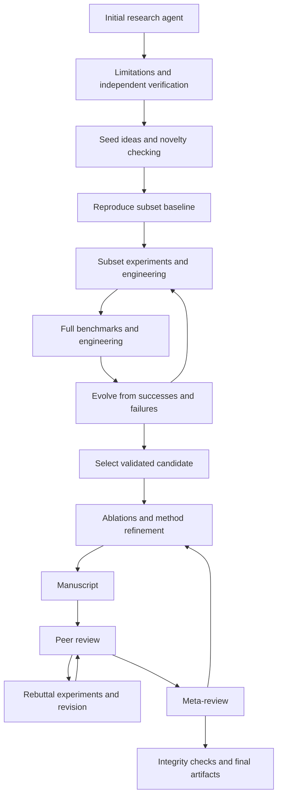

# Metis

**An open-source AI research platform that keeps every attempt, including the ones that failed.**

Metis takes a research question through literature review, ideation, coded experiments,
peer review and a written manuscript. Every model call, command, measurement and rejected
idea is recorded, so you can check how a conclusion was reached instead of trusting a
final summary. Use the web console, the terminal interface or the CLI.

<picture>
  <source media="(prefers-color-scheme: light)" srcset="docs/images/console-demo-light.png">
  
</picture>

<sub>The offline demo in the web console. Agents and review scores are scripted; the experiments run for real on synthetic data.</sub>

[](https://github.com/tadteo/Metis/actions/workflows/ci.yml)

**[Getting started](docs/getting-started.md)** · **[Documentation](docs/README.md)** ·
**[User guide](docs/usage.md)** · **[Troubleshooting](docs/troubleshooting.md)**

## Try the offline demo

Requires Git, Python 3.11+ and [uv](https://docs.astral.sh/uv/getting-started/installation/).
No account, API key, Docker or model spending is needed. The first install downloads
dependencies; subsequent demo runs work offline.

```bash
git clone https://github.com/tadteo/Metis.git
cd Metis
uv sync --frozen
uv run --no-sync metis demo
uv run --no-sync metis serve
```

Open [http://127.0.0.1:8765](http://127.0.0.1:8765) and select the saved demo.
Keep the server running while you inspect the record. Prefer the terminal?
`uv run --no-sync metis tui` opens the same research history.


The demo uses scripted agents and review scores with real local experiments on
synthetic data. It exercises the software, without establishing a scientific result.
The [getting-started guide](docs/getting-started.md) walks through installation,
model access, compute, a first live inquiry and upgrades.

## What sets Metis apart

- **Failures are evidence.** Rejected hypotheses, failed commands and negative measurements
  are kept and fed back into later ideas. Nothing is deleted to make a run look better.
- **Measured claims only.** A candidate is promoted only by measurements from a protected
  evaluator the agents cannot edit. Numbers and statistics in the manuscript are checked
  against recorded results.
- **Budget limits.** Spending and call limits are reserved before each model call;
  experiment and wall-clock limits are checked before each experiment and step. Creating
  or configuring a run never spends anything.
- **Inspectable AI.** Agents, prompts, routing and the workflow are versioned
  [specifications](src/autoresearch/specs/). Each run archives them and detects drift on resume.
- **Your models, your compute.** OpenAI-compatible APIs, including local servers, with
  [sourced provider presets](docs/model-routing.md#provider-presets) for free tiers and for
  OpenAI, Anthropic Claude (native adapter), Gemini Pro and DeepSeek; Docker, Podman,
  Apptainer, a native OS sandbox (with Apple GPU access), local or Slurm execution;
  managed SSH controllers for remote hosts.

## Status and scope

Metis 0.1.0 is an experimental preview, developed independently by a single maintainer.
It draws on [ScientistTwo (Nam et al., arXiv:2609.19644)](https://arxiv.org/abs/2609.19644)
and extends its research loop with its own architecture, interfaces, execution policies
and evidence tracking. It has no affiliation with the authors and makes no claim of
reproducing the paper's scientific performance. Live manuscripts use pinned official
PaperOrchestra agents; peer review uses the released ScholarPeer Appendix G prompts with
reconstructed orchestration.

The offline demo is synthetic. Public-data baseline measurements do not establish
autonomous research quality, and paid end-to-end runs have not yet been certified. Read
the [fidelity report](docs/fidelity.md) before using any output as research evidence.
Read the [security guide](SECURITY.md) before connecting private research.

Contributions are welcome: see [CONTRIBUTING.md](CONTRIBUTING.md). Sharing a recorded
live run is especially valuable, because it is the evidence this project needs most.

## Start real research

1. Open **Settings → Available to Metis → ＋ Add provider** to choose models
   and save a provider key. Use **Configure** to edit an existing model, or add
   a compatible local server. Keys live on the controller host, in its supported OS
   vault or explicitly for the server session. See [provider setup](docs/usage.md#add-providers-from-presets).
2. Choose available [experiment compute](docs/execution-options.md). Docker is the
   default; live manuscripts also need [PaperOrchestra setup](docs/paper-orchestra.md#setup).
   Use [managed SSH](docs/remote.md) when your project lives on another host.
3. Choose **New research**, enter a question and a model budget, and optionally add
   papers or a project folder. Choose **Check setup**, create the idle run and review
   it. **Start**, **Step** or **Resume** explicitly executes research and can incur charges.

For terminal setup and scripting:

```bash
uv run --no-sync metis setup
uv run --no-sync metis new \
  --objective 'Investigate a documented limitation of the reference method' --budget 25
uv run --no-sync metis run RUN_ID --steps 1
```

Replace `RUN_ID` with the identifier returned by `new`. A step can contain several
model calls or a long experiment. Creating a run makes no model call. Model budgets
use recorded/estimated API costs; compute and storage are separate. Read
[accounting](docs/accounting.md) before choosing limits.

The agents discover literature, inspect admitted inputs and prepare baseline code
and protected measurements. Missing evidence, credentials or compute remain visible
blockers. Imported configured studies retain their explicit compatibility path;
existing saved runs retain behavior-drift checks.

## Research workflow



The research contracts, paper-derived defaults, stopping conditions, unsuccessful outcomes and local design choices are in [paper-spec.md](docs/paper-spec.md). Scientific rejection and failed experiments remain available for subsequent evolution. Budget limits do not authorize skipping stages or inventing successful outcomes.

## Find your next step

| I want to… | Guide |
|---|---|
| Install, try the demo or start my first live inquiry | [Getting started](docs/getting-started.md) |
| Use the web console, terminal or run controls | [Using Metis](docs/usage.md) |
| Find a command or flag | [Generated CLI reference](docs/cli.md) |
| Configure providers, model roles and quotas | [Model routing](docs/model-routing.md) |
| Choose containers, native sandbox, GPU or Slurm | [Execution options](docs/execution-options.md) |
| Run a controller over SSH | [Remote connections](docs/remote.md) |
| Set up manuscript writing and PDF output | [PaperOrchestra](docs/paper-orchestra.md) |
| Understand private state, resume or reproduce a run | [Reproducibility](docs/reproducibility.md) |
| Diagnose an error | [Troubleshooting](docs/troubleshooting.md) |
| Inspect agents, prompts, routing and workflow | [AI system](docs/ai-system.md) |
| Assess scientific capability and remaining gaps | [Fidelity report](docs/fidelity.md) |

Private state defaults to `~/.local/state/autoresearch`, outside the repository.
`AUTORESEARCH_HOME` or the global `--state-dir` option selects another location.
Exports contain metadata by default; private exports and raw run artifacts need
review before sharing. The package is `metis-research`; `autoresearch` remains a
command/import compatibility name, alongside `AUTORESEARCH_*` environment variables.

## Develop and contribute

```bash
uv sync --frozen --group dev --extra evaluation
uv run --no-sync python scripts/check_docs.py
uv run --no-sync pytest
```

Read [CONTRIBUTING.md](CONTRIBUTING.md) for the full validation commands and
[the development workflow](docs/development.md) for isolated branches, independent
review and completion evidence. [VIBE.md](VIBE.md) defines interface design and voice.
[Architecture](docs/architecture.md) and the [AI system guide](docs/ai-system.md)
describe extension contracts. The [documentation index](docs/README.md) includes
scientific, evaluation and specialist guides.

CI checks the test suite, types, formatting, browser logic, public files, installed
wheel and synthetic demo. Documentation checks cover local links, images, heading
anchors and the generated CLI reference. A separate official-writer job exercises
pinned source/SDKs with deterministic responses. These checks do not certify paid
writing, live Docker/TeX execution, reviewer calibration or research performance.

Development retains its honest prototype import (`6936a17`) and focused, tested,
independently reviewed branches. See [fidelity-report.md](fidelity-report.md) for
component commits and evidence. Released under [Apache License 2.0](LICENSE).
